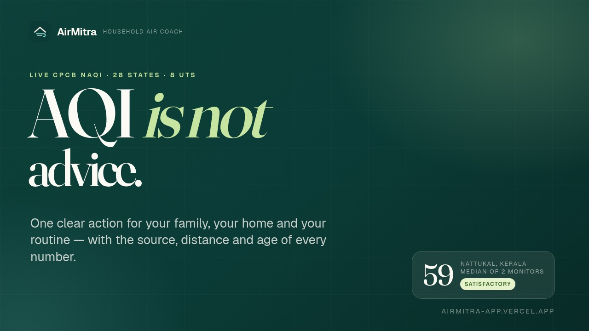

# AirMitra — Household Air Coach

> **Live:** https://airmitra-app.vercel.app  
> **Built for:** PromptWars Virtual · Main Challenge 06 (Urban Air Quality Assistant)

AirMitra tells an Indian household what to do about the air today — for their
people, their home, and their routine — and why it matters. It is a data-first
PWA with a grounded GenAI brief, not a chat-only app.

## Demo video

[Play the 1:45 demo](https://mrashieee.github.io/airmitra-challenge6/) ·
[MP4](https://github.com/mrashieee/airmitra-challenge6/releases/download/demo-video/AirMitra_Promo_1080p.mp4) ·
[thumbnail](docs/video/Thumbnail_1280x720.jpg)

[](https://mrashieee.github.io/airmitra-challenge6/)

## What it does

- **Live AQI** from CPCB ground stations, then OpenAQ monitors, then CAMS model
  data. Cities with 2+ official monitors use the **median** and show the range.
- **Where the data comes from** is always visible: station name, distance,
  freshness, and a `ground monitor` / `model estimate` label.
- **City pages** at `/aqi/<state>/<city>` with canonical metadata and a sitemap.
- **Language first** — 13 Indian languages (English, Hindi, Malayalam, Tamil,
  Telugu, Kannada, Marathi, Bengali, Gujarati, Punjabi, Odia, Urdu, Assamese).
  Hindi and Malayalam are hand-checked; the other packs are machine-assisted.
  The interface, the brief and the answers follow the choice.
- **Household profile** — you, family, conditions, home inventory, routine.
  Starts with **You**; no invented family members. The last setup step is
  **Accessibility**: text size and light / dark / system theme.
- **Grounded GenAI brief and ask** (`gemini-3.1-flash-lite` → lite fallback →
  deterministic templates). The model writes; the data layer decides.
- **Time-aware guidance** — the GenAI brief refreshes hourly, “Do now” and
  “If you must go out” change by morning / afternoon / evening / night, and the
  give-back idea rotates daily. “Refresh now” regenerates the brief on demand.
- **Status / story cards** — high-quality story image with time windows,
  actions, the impact payoff and one give-back idea (plant a native tree,
  compost, or leave the car), shareable to WhatsApp, X, Telegram, Facebook,
  LinkedIn, or Instagram (download + caption).
- **Inline settings** — every field editable without the setup wizard.
- **Weather-aware hero** with day/night sun, moon, stars, clouds, rain and fog,
  plus the current condition, temperature and wind speed.
- **PWA** — installable, responsive, reduced-motion aware, true-black dark mode.

## Data chain

```
CPCB (data.gov.in) ─┐
OpenAQ (<=30 km) ───┼─> median of official stations (<=15 km)
nearest monitors ───┤   (<=60 km, median, labelled approximate)
CAMS (Open-Meteo) ──┘   only when no live monitor is within 60 km
                        and the model timestamp is <= 3 hours old
```

- AQI uses **CPCB NAQI**, not US AQI. The US equivalent is shown for comparison.
- Stale OpenAQ sensor rows are discarded (freshness window relative to the
  station's newest reading).
- If no monitor is within 30 km, the app uses the **median of up to three live
  monitors within 60 km** as an approximate reading, with the distance range
  shown. CAMS is used only when no live monitor exists within 60 km, and only
  when its own timestamp is within 3 hours.

## Architecture

```
app/
  page.tsx                     app shell entry
  aqi/[state]/[city]/page.tsx  public city pages
  api/{aqi,search,geocode,reverse,ask,brief,health}/
components/
  app-shell, home-view, panels, settings-panel, profile-editor,
  location-picker, onboarding, share-cards, weather-scene, aqi-number
lib/
  air/            providers (CPCB, OpenAQ, CAMS, nearby), resolve, cache, NAQI
  ai/             context, prompts, client, templates, cache keys
  city-index.ts   curated + GeoNames city index with monitor tags
  profile*.ts     types, defaults, migrations, server allow-list
  api-guard.ts    body limits, validation, rate limiting
  story-image.ts  canvas story renderer
data/
  states.json, cities.json, city-index.json
scripts/
  build-city-index.mjs         regenerate the city/monitor index
```

## Security & privacy

- **No accounts, no PII, no analytics.** The profile and saved settings stay in
  `localStorage`. AI routes receive a sanitised profile to generate advice but
  do not persist it.
- **Secrets are server-side only** (`.env`, gitignored). No secret is exposed to
  the browser.
- **Allow-listed inputs** on AI routes: profile fields are sanitised and capped
  server-side before they enter the prompt; question text is length- and
  control-character-limited.
- **Rate limits** on AI and data routes (per IP, in-memory).
- **CSP and security headers** in production: `default-src 'self'`,
  `frame-ancestors 'none'`, `nosniff`, `Referrer-Policy`, `Permissions-Policy`,
  HSTS, no `X-Powered-By`.
- **Prompt-injection guardrail:** context and questions are treated as data, not
  instructions.
- **No diagnosis or prescriptions.** If symptoms look urgent, the UI says to see
  a doctor.

## Run locally

```bash
npm install
cp .env.example .env   # add keys (see below)
npm run dev
```

Open http://localhost:3000.

```bash
npm run typecheck   # tsc --noEmit
npm run lint
npm run build
npm run index:cities   # rebuild data/city-index.json
```

## Environment

| Variable | Purpose |
|---|---|
| `GEMINI_API_KEY` | Gemini, server-side only |
| `GEMINI_MODEL` | Primary model (default `gemini-3.1-flash-lite`) |
| `GEMINI_MODEL_FALLBACK` | Fallback lite model |
| `DATA_GOV_API_KEY` | CPCB real-time AQI (data.gov.in) |
| `OPENAQ_API_KEY` | OpenAQ ground fallback |
| `OPEN_METEO_*` | CAMS + weather endpoints (no key) |
| `AQI_CACHE_TTL_SECONDS` | Air cache TTL (default 900) |
| `LLM_CACHE_TTL_SECONDS` | AI response cache TTL |

## Known limitations

- `data.gov.in` is unreachable from Vercel's network, so production uses
  OpenAQ → CAMS. CPCB remains first when reachable.
- Some towns have no continuous monitor; they show CAMS model data and nearby
  monitor context.
- Manual NAMP samples are not used live (they can be months old).
- The 13 language packs are machine-translated and then hand-checked for the
  most visible Hindi and Malayalam strings. Gemini-generated advice follows the
  chosen language; if Gemini is unavailable, the localized rule templates are
  used.

## License

Code is MIT licensed. See `LICENSE`. Data files keep their upstream licenses:
GeoNames (CC BY 4.0), OpenAQ, CPCB/data.gov.in, Open-Meteo/CAMS, and
OpenStreetMap/Photon. Attribution is in the README and on each city page.

## AI disclaimer

AirMitra uses Gemini to draft the daily brief and answer questions. The output
is generated text, not a verified fact, and it can be incomplete or wrong even
when the AQI is correct. It is grounded in the supplied reading and profile,
but it is not independently checked.

AirMitra is **not** a medical service. It does not diagnose, prescribe, or
replace a doctor. For breathlessness at rest, chest tightness, or any emergency,
seek medical help immediately.

Air quality data can be delayed, sparse, or wrong. Model estimates and nearby
monitor context are labelled. Do not use AirMitra for regulatory, legal, or
safety-critical decisions.

## Data credits

CPCB / data.gov.in, OpenAQ, Open-Meteo (CAMS), GeoNames (CC BY 4.0), and
OpenStreetMap/Photon for geocoding.
