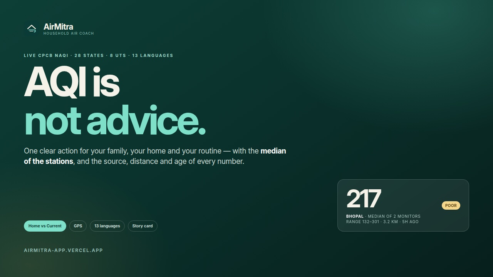

# AirMitra — demo video

**Play:** https://mrashieee.github.io/airmitra-challenge6/

**MP4:** [AirMitra_Promo_1080p.mp4](https://mrashieee.github.io/airmitra-challenge6/video/AirMitra_Promo_1080p.mp4) — 1:45, 1920×1080, 30 fps, H.264/AAC.

**Live app:** https://airmitra-app.vercel.app

## What the video covers

- Live Indian AQI from CPCB, OpenAQ and CAMS, with station freshness
- Language-first setup across 13 Indian languages
- A household brief that changes with the people, home and routine
- Weather-aware day/night hero
- Time-aware guidance: hourly GenAI brief, period-specific do-now/must-go advice, daily give-back idea
- High-quality story card with a give-back action
- Privacy: no accounts, no analytics, no PII, no ads; profile stays on the device

The video is a recorded snapshot; live AQI and AI guidance change with the current data and time of day.
